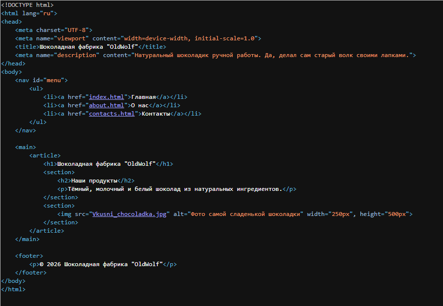
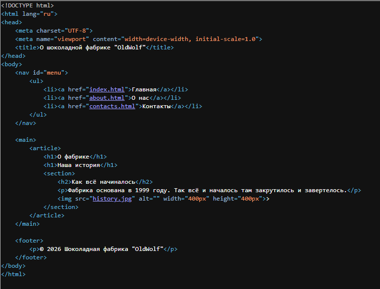
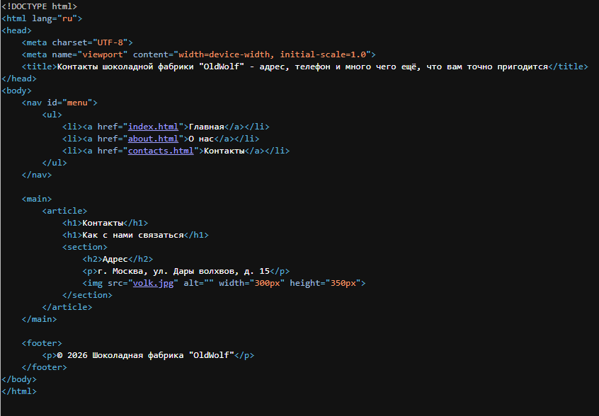
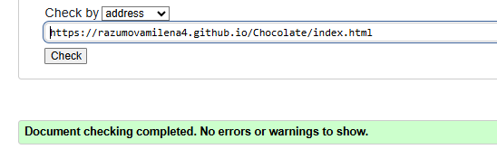
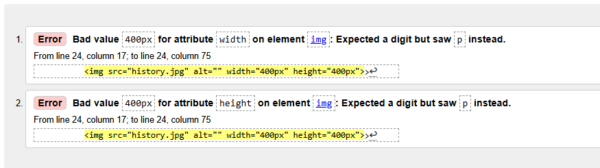
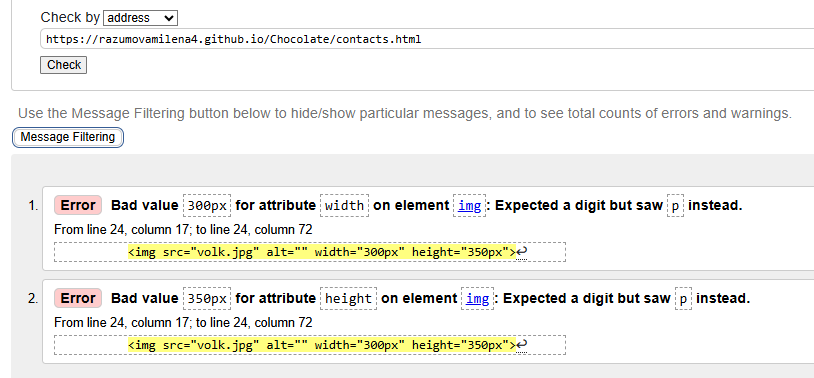
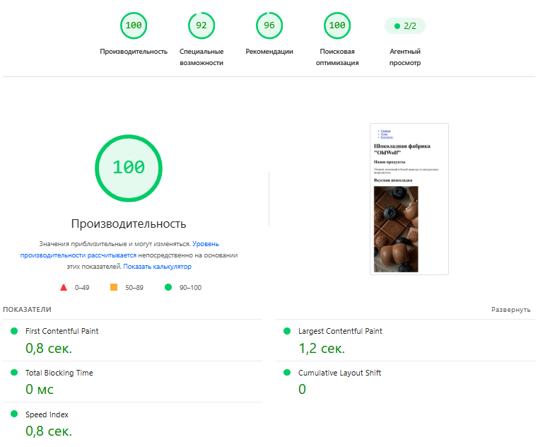
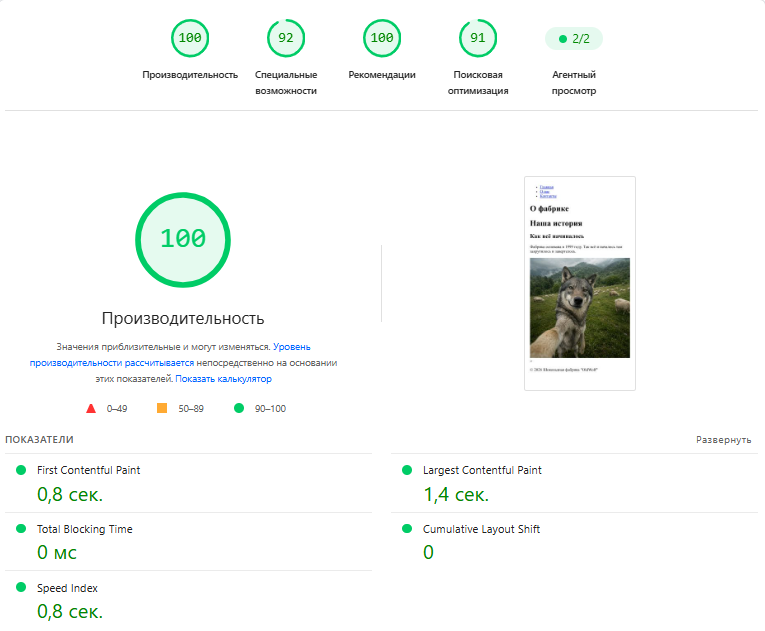
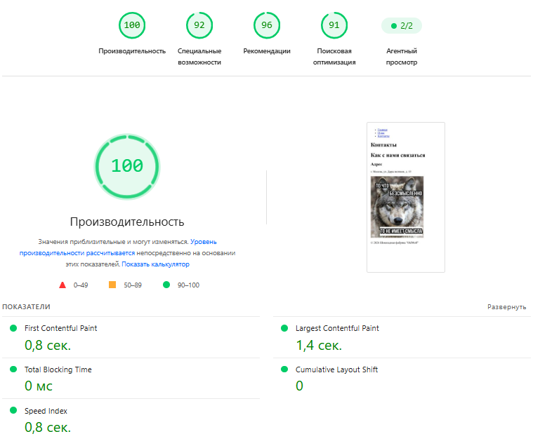

<h3>Практическая работа 5 - Сниппеты, SEO-теги и семантическая разметка</h3>  

2. Задание
   
2.1. Создание сайта из 3 страниц  

Необходимо разработать сайт, состоящий из:  
- index.html  
- about.html  
- contacts.html  

Требования:  
- каждая страница содержит корректную структуру (header/nav/main/footer);  
- на главной странице SEO оформлены идеально;  
- на двух страницах - преднамеренные типичные ошибки:  
- два h1;  
- пустой alt;  
- отсутствующий description;  
- слишком длинный 'title'.

Главная страница:

О нас:

Контакты:

2.2. Публикация на GitHub Pages  
- Создать GitHub-репозиторий  
- Загрузить HTML-файлы  
- Включить GitHub Pages  
- Проверить доступность:  https://razumovamilena4.github.io/Chocolate/index.html  

2.3. Проверки SEO и качества кода  
Провести анализ каждой страницы:  
- W3C Validator - валидность HTML  
- PageSpeed Insights - показатели Core Web Vitals  
- Яндекс.Вебмастер:  
- подключение сайта;  
- загрузка файла подтверждения;  
- проверка индексации.  
Сделать скриншоты:  
- Валидация HTML (ошибки/предупреждения)  
- Результаты скорости  
- Уведомления Вебмастера

Проверка W3C Validator

Проверка PageSpeed Insights

2.4. Описание и анализ ошибок  
Для двух страниц с ошибками составить:  
таблицу ошибок,  
описание причины,  
влияние на SEO,  
что нужно исправить и почему.  

Таблица ошибок для страниц about и contacts:

| Тип ошибки                              | На какой странице             | Причина появления                                                                       | Что и как нужно исправить                                                                                                                                     | Влияние на SEO                                                                                            |
| --------------------------------------- | ----------------------------- | --------------------------------------------------------------------------------------- | ------------------------------------------------------------------------------------------------------------------------------------------------------------- | --------------------------------------------------------------------------------------------------------- |
| Два тега `<h1>`                         | `about.html`, `contacts.html` | Ошибка верстки. Разработчик использовал главный заголовок для разных смысловых блоков.  | Поисковый робот не понимает, какая тема у страницы главная. Это размывает релевантность, и страница может ранжироваться ниже конкурентов.                     | Оставить только один `<h1>` (главный заголовок). Второй заголовок заменить на `<h2>`.                     |
| Пустой атрибут `alt`                    | `about.html`, `contacts.html` | Изображения добавлены тегом `` без текстового описания (`alt=""`).                 | Поисковик не понимает, что на картинке, и она не попадет в поиск по изображениям. Также страдает доступность для незрячих пользователей (скринридеры).        | Добавить осмысленное описание в атрибут. Пример: `alt="Цех шоколадной фабрики"`.                          |
| Отсутствует `<meta name="description">` | `about.html`, `contacts.html` | Тег забыли добавить в секцию `<head>`.                                                  | Поисковая система сама сформирует описание (сниппет) из случайного текста на странице. Это делает сниппет некрасивым и снижает CTR (кликабельность) в поиске. | Добавить в `<head>` тег `<meta name="description" content="...">` с уникальным описанием до 160 символов. |
| Слишком длинный `<title>`               | `about.html`, `contacts.html` | В заголовок попытались вместить максимум ключевых слов, не учитывая лимиты поисковиков. | В результатах поиска заголовок обрежется (появится многоточие). Пользователь не увидит конца фразы, и кликабельность снизится.                                | Сократить `<title>` до 55–60 символов. Оставить самое важное.                                             |

3. Контрольные вопросы  
**Что формирует сниппет и как на него влияет HTML-код?**

Сниппет - это блок информации в результатах поиска, который состоит из заголовка (тег `title`), ссылки (URL) и краткого описания (тег `meta name="description"`). HTML-код влияет на сниппет напрямую: если в коде правильно заполнены эти теги, поисковик покажет аккуратный и понятный сниппет. Если description нет, поисковик возьмет случайный кусок текста со страницы, и сниппет может выглядеть некрасиво, что снизит кликабельность.

**Какие SEO-теги обязательны на каждой странице?**  

К обязательным относятся: `title` (уникальный заголовок страницы до 60 символов), `meta name="description"` (описание до 160 символов), `h1` (один главный заголовок на странице), а также атрибут alt для всех изображений (тег `img`). Также важно указывать кодировку (`meta charset="UTF-8"`) и адаптивность (`meta name="viewport"`).

**Почему нельзя использовать несколько 'h1'?**  

Тег `h1` обозначает главный заголовок страницы. Он должен быть один, чтобы поисковый робот четко понимал, о чем эта страница и какой у нее главный смысл. Если тегов `h1` несколько, поисковик путается и не может определить главную тему, из-за чего страница может ранжироваться хуже.

**Зачем нужен alt и как он влияет на SEO?**  

Атрибут alt нужен для текстового описания изображения. Он помогает поисковым системам понять, что нарисовано на картинке, благодаря чему изображение может попасть в поиск по картинкам и привести дополнительный трафик. Кроме того, alt важен для доступности: программы для незрячих людей (скринридеры) читают этот текст вслух.

**Почему важно уникализировать 'title' и 'description'?**  

Если на разных страницах сайта одинаковые заголовки и описания, поисковик воспринимает такие страницы как дубликаты. Это приводит к внутренней конкуренции страниц: они "мешают" друг другу выходить в топ. Уникальные теги помогают поисковику понять, чем одна страница отличается от другой, и показать пользователю самый точный результат.

**Чем OpenGraph отличается от поисковых тегов?**  

Поисковые теги (title, description) используются для формирования выдачи в Яндексе и Google. OpenGraph (теги og:title, og:description, og:image) используется для красивых превью ссылок в социальных сетях и мессенджерах (ВКонтакте, Telegram). То есть при отправке ссылки другу, соцсеть возьмет картинку и заголовок именно из OpenGraph.

**Какие ошибки чаще всего приводят к плохой индексации?**  

Самые частые ошибки: отсутствие файла robots.txt или неправильные директивы в нем (когда весь сайт случайно закрыт от роботов), дублирование страниц (одинаковый контент по разным адресам), отсутствие карты сайта sitemap.xml, битые ссылки (ошибки 404), а также медленная загрузка страниц.

**Как скорость загрузки влияет на ранжирование?**  

Скорость загрузки напрямую влияет на поведенческие факторы. Если страница грузится долго, пользователи просто закрывают ее и уходят к конкурентам. Поисковые системы видят это (низкое время на сайте, высокий процент отказов) и понимают, что сайт неудобен, поэтому понижают его в выдаче. Кроме того, скорость загрузки - это официальный критерий ранжирования (особенно для мобильных устройств).

